**Full Stack Developer** · Systems Engineering graduate · Cajamarca, Peru

## About

I hold a Bachelor's degree in Systems Engineering from the Universidad Nacional de Cajamarca. I build web and mobile products from the database to the interface: complete applications, optimized data models and projects run with agile methodologies.

I like working in teams, leading when needed, and I keep learning to bring real value to every project. I am available for projects in Cajamarca and remotely.

## What I do

- **Web applications** — interfaces with React and Next.js, backends with Laravel and Node.js.
- **Mobile apps** — cross-platform with Flutter and React Native, native Android with Kotlin and Jetpack Compose.
- **Data** — relational schemas and query optimization in MySQL and PostgreSQL.
- **Delivery** — Git workflows, Docker, REST APIs and Scrum.

## Tech stack

| Area | Technologies |
| --- | --- |
| Frontend | React, Next.js, HTML, CSS, JavaScript, Tailwind CSS |
| Backend | Laravel (PHP), Express.js (Node.js), Microservices (Maven) |
| Mobile | React Native, Flutter, FlutterFlow, Dart, Kotlin, Jetpack Compose, Java (Android Studio) |
| Databases | MySQL, PostgreSQL, SQLite |
| Tools and methods | Git, Docker, REST API, Scrum |

## Education

**B.Sc. in Systems Engineering** — Universidad Nacional de Cajamarca, July 2024.
A five-year program focused on software engineering, databases and project management.

**Certifications**

- Create My First Website — CódigoFacilito, January 2025
- Professional Excel Update — Skill, Newmont Yanacocha, December 2023

## Contact

- Portfolio: [richardmalca.vercel.app](https://richardmalca.vercel.app)
- LinkedIn: [linkedin.com/in/richardmalca](https://linkedin.com/in/richardmalca)
- Email: [malcarichard6@gmail.com](mailto:malcarichard6@gmail.com)
- WhatsApp: [+51 936 036 606](https://wa.me/51936036606)
